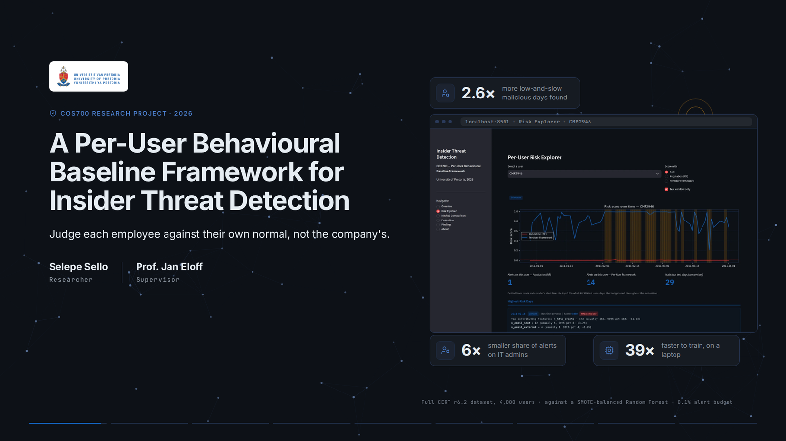

# Per-User Behavioural Baseline Framework for Insider Threat Detection

> Judge each employee against their own normal, not the company's. A lightweight insider threat detector that profiles every user from their own history, falls back to their role when the history is short, and scores each day's deviations with one cheap anomaly model, tested on the full CERT r6.2 dataset against the SMOTE-balanced Random Forest of current practice.

Try the live dashboard at [cos700research.tebogoyungmercykay.co.za](https://cos700research.tebogoyungmercykay.co.za), or read the [research report](report/Report.pdf) for the method, the results and their limits.

---

## Documentation

| Doc                                                         | Description                                                                  |
| ----------------------------------------------------------- | ---------------------------------------------------------------------------- |
| [Research Report](report/Report.pdf)                        | The COS700 report, from the problem to the results and their limits          |
| [Setup Guide](docs/setup-guide.md)                          | Installing, preparing the dataset, training and launching the dashboard      |
| [Running the Experiments](docs/running-the-experiments.md)  | The laptop and full-population runs, with measured memory and time per step  |
| [Dataset Download](data/README.md)                          | Getting the CERT r6.2 archives and where to place them                       |
| [Dataset Notes](docs/dataset-notes.md)                      | Answer-key conversion, LDAP handling and other CERT releases                 |
| [Data Pipeline](docs/data-pipeline.md)                      | Reducing 93 GB of logs on a 32 GB machine, cohorts and the bugs it fixed     |
| [Evaluation](docs/evaluation.md)                            | The comparison set, the alert budget, the metrics and the follow-up studies  |
| [Deployment](docs/deployment.md)                            | The Docker image and the AWS setup behind the live dashboard                 |
| [Coding Standards](docs/coding-standards.md)                | Project structure, code style, comments, tests and correctness rules         |
| [Contributing](CONTRIBUTING.md)                             | How to raise issues and changes, branches and commit messages                |
| [Code of Conduct](CODE_OF_CONDUCT.md)                       | Expected behaviour in this project's spaces                                  |
| [Security Policy](SECURITY.md)                              | How to report a vulnerability privately                                      |

---

Released under the [MIT License](LICENSE).

_COS700 Research Project, University of Pretoria, 2026. Selepe Sello, supervised by Prof. Jan Eloff._
